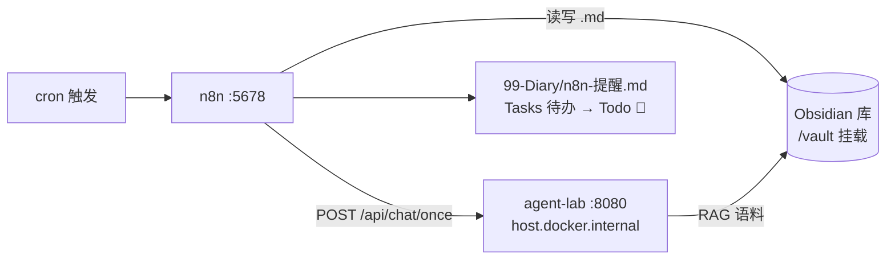

# flow-lab

> 远程仓：https://github.com/sunhuoxyr/flow-lab（private）

个人**业务自动化流程**练习场（n8n）。与 agent-lab 分层：agent-lab 学模型接入原理，本仓让流程出活。

## 栈

n8n（Docker，:5678）· 触发器/定时 + Code 节点（JS）· Obsidian 库目录挂载进容器（`/vault`）



## 启动

```bash
docker compose up -d          # 首次拉 n8n 镜像
# 打开 http://localhost:5678 → 首次创建 owner 账号（仅本机）
```

工作流 JSON 在 `workflows/`，改完用 CLI 再导入：

```bash
docker exec flow-lab-n8n n8n import:workflow --input=/workflows/<file>.json
# 导入后是 inactive，UI 里手动 Activate
```

## 流程清单

| 流程 | 触发 | 干什么 | 出口 |
| --- | --- | --- | --- |
| 记账月历提醒 | 每月 1/15 号 10:00 | 1 号：当月 `60-投资/记账/YYYYMM.md` 不在 → 待办；15 号：提醒核对上月总览+大额台账 | 追加到 `99-Diary/n8n-提醒.md`（Tasks 格式，进 Todo 🎯 看板） |

## 加第二个流程的姿势

1. UI 里拖出来 → Export JSON → 存 `workflows/`（版本化）
2. 或直接照 `accounting-monthly.json` 写 → CLI 导入
3. 要 LLM：HTTP Request 节点 → agent-lab（`host.docker.internal:8080`）或 DeepSeek 直连

## backlog

库治理周报（Draft 超龄清单）· 记账总览空表检测（解析 markdown 表空格）· LLM 每日库变更一句摘要（串 agent-lab）
